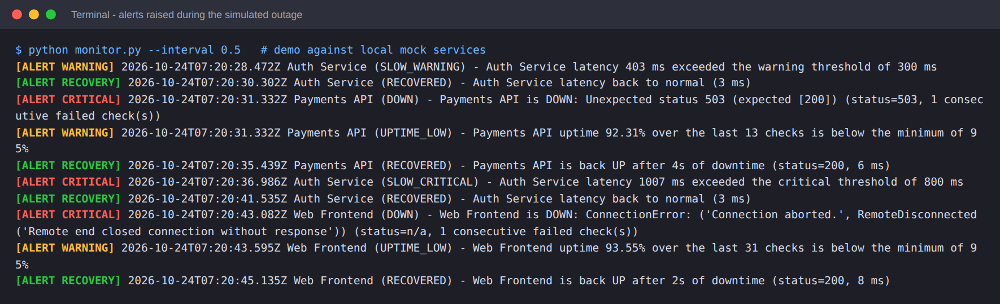
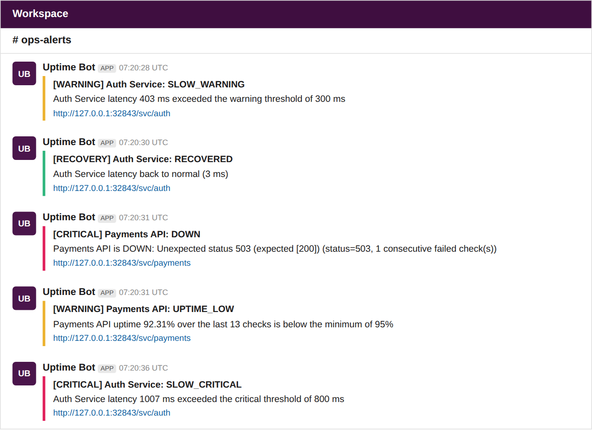
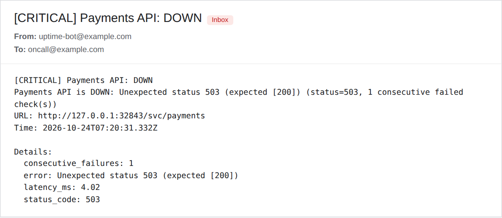
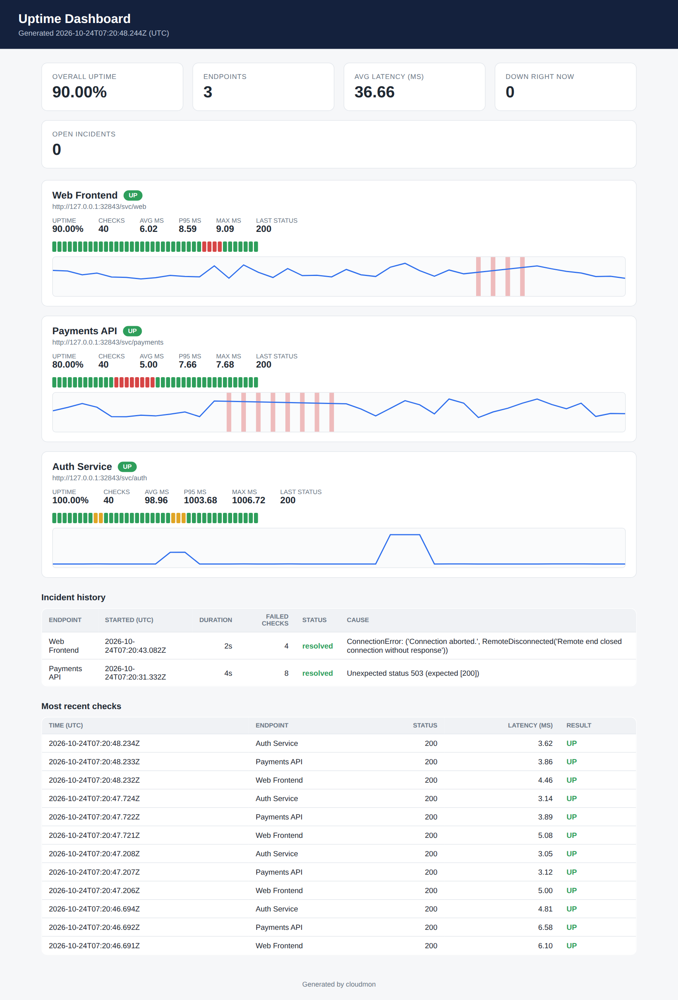
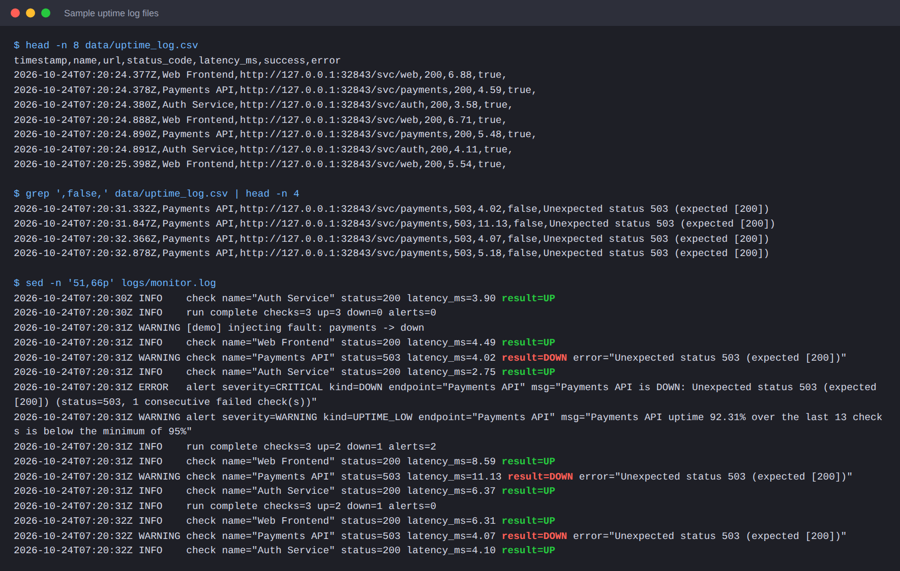
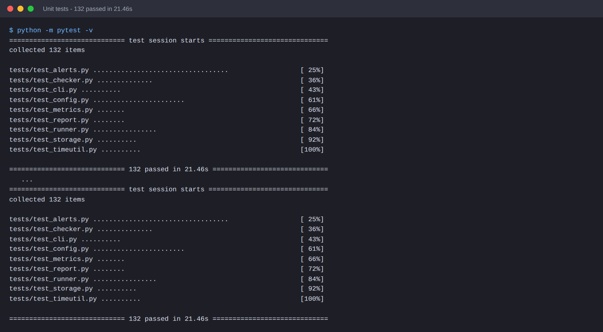

# Cloud Monitoring Project - Telemetry & Automated Alerting

A small, dependency-light uptime monitor (Python + `requests`) that

* pings HTTP(S) endpoints on a schedule,
* records **latency (ms)**, **HTTP status** and **success/failure** for every check,
* computes **uptime %**, avg / p95 / max latency and incident history,
* fires **alerts** (console, webhook, e-mail) the moment a threshold is breached,
* publishes a **Markdown uptime report** and a self-contained **HTML dashboard**,
* runs for free on a **GitHub Actions cron workflow** (or local cron) - no server needed.

```
 GitHub Actions cron (*/5)         monitor.py --once
 ───────────────────────►  ┌──────────────────────────────┐
                           │ checker  → HTTP GET, ms timer│
  config.json ───────────► │ storage  → data/uptime_log.csv│
                           │ alerts   → state machine     │──► console / webhook (Slack, Discord…) / e-mail
                           │ report   → reports/*.md,html │
                           └──────────────┬───────────────┘
                                          ▼
                     logs, state & reports committed back to the repo
```

## Project layout

| Path | Purpose |
|---|---|
| `monitor.py` | CLI entry point (`--once`, loop mode, `--simulate-down`, `--report-only`) |
| `config.json` | Endpoints, thresholds, alert channels, storage paths |
| `cloudmon/checker.py` | Single endpoint probe (latency in ms, never raises) |
| `cloudmon/alerts.py` | Threshold state machine + console / webhook / e-mail delivery |
| `cloudmon/metrics.py`, `report.py` | Uptime %, percentiles, incidents; Markdown + HTML output |
| `cloudmon/storage.py`, `runner.py`, `config.py` | CSV log + state, orchestration, validation |
| `.github/workflows/monitor.yml` | **Scheduled monitoring workflow** (every 5 min) |
| `.github/workflows/ci.yml` | Runs the unit tests on push / PR |
| `data/uptime_log.csv`, `logs/monitor.log`, `reports/` | **Sample logs & reports** from a real demo run |
| `tests/` | 132 unit / integration tests |
| `demo/` | Local mock services, demo runner, screenshot generator |
| `docs/screenshots/`, `docs/captured/` | Screenshots + the raw captured console / webhook / e-mail output |

## Quick start (local)

```bash
python -m venv .venv && source .venv/bin/activate      # Windows: .venv\Scripts\activate
pip install -r requirements.txt

python monitor.py --once                    # one round, then exit
python monitor.py                           # loop forever every interval_seconds
python monitor.py --once --simulate-down    # simulate an outage on every endpoint
python monitor.py --report-only             # rebuild reports from data/uptime_log.csv
```

Open `reports/dashboard.html` in a browser, or read `reports/uptime_report.md`.

Local cron alternative (every 5 minutes):

```cron
*/5 * * * * cd /path/to/cloud-monitor && /usr/bin/python3 monitor.py --once >> logs/cron.out 2>&1
```

## Alerting threshold configuration

All thresholds live in `config.json` under `"thresholds"`; each endpoint may override any of them with its own `"thresholds"` block (see *GitHub API* in the shipped config).

| Setting | Default | Meaning |
|---|---:|---|
| `latency_warning_ms` | 800 | Response slower than this → **WARNING** `SLOW_WARNING` |
| `latency_critical_ms` | 2000 | Response slower than this → **CRITICAL** `SLOW_CRITICAL` |
| `consecutive_failures` | 1 | Failed checks in a row before **CRITICAL** `DOWN` fires. `1` = alert immediately; use `2`-`3` to ignore one-off blips |
| `uptime_min_percent` | 99.0 | Rolling uptime below this → **WARNING** `UPTIME_LOW` |
| `uptime_window_checks` | 100 | Number of most recent checks used for rolling uptime |
| `uptime_min_checks` | 10 | Minimum samples before the uptime alert can fire (avoids noise on a fresh log) |

Other useful settings: `interval_seconds` (loop mode), `timeout_seconds` (a timeout counts as a failure), per-endpoint `expected_status` (int or list), `expected_text` (body must contain it), `method` (`GET`/`HEAD`), and `storage.retention_days` (old CSV rows are pruned).

**Alert behaviour.** Alerts fire on *state changes*, not on every bad check: one `DOWN` alert when an outage starts, one `RECOVERED` alert (with the downtime duration) when it ends. A failure while the endpoint is already DOWN does not re-alert, and the state is persisted in `data/state.json`, so it survives between separate GitHub Actions runs.

| Kind | Severity | Fires when |
|---|---|---|
| `DOWN` | CRITICAL | non-expected status, timeout, connection error, missing expected text |
| `SLOW_WARNING` / `SLOW_CRITICAL` | WARNING / CRITICAL | latency ≥ threshold (escalation warning → critical alerts again) |
| `UPTIME_LOW` | WARNING | rolling uptime % below the minimum |
| `RECOVERED`, `UPTIME_RECOVERED` | RECOVERY | back to normal |

### Alert channels

* **Console** - always on by default (`"console": true`); coloured in a terminal.
* **Webhook** - set the URL in the `ALERT_WEBHOOK_URL` environment variable (or `alerts.webhook.url`). The JSON body contains `text` (Slack) and `content` (Discord) plus a full `alert` object, so Slack and Discord incoming webhooks work as-is; any other service can consume the `alert` object. Failed deliveries are retried (`attempts`).
* **E-mail (SMTP)** - set `alerts.email.enabled` to `true`, fill `smtp_host`, `from`, `to`, and provide `SMTP_USERNAME` / `SMTP_PASSWORD` as environment variables (for Gmail use an *app password*).
* **GitHub's own notification** - the workflow runs with `--fail-on-down`, so a failed check turns the run red and GitHub sends its normal "workflow failed" notification with no setup at all.

A channel that fails (bad URL, SMTP error) is logged and never stops the other channels or the monitor.

## Deploy on GitHub Actions (free, no server)

1. Create a GitHub repository and push this project (`git init && git add . && git commit -m init && git push`).
2. Edit `config.json` and list your own endpoints.
3. *(Optional)* **Settings → Secrets and variables → Actions → New repository secret** → add `ALERT_WEBHOOK_URL` (and `SMTP_USERNAME` / `SMTP_PASSWORD` if you enable e-mail).
4. **Settings → Actions → General → Workflow permissions** → *Read and write permissions* (the workflow commits the log files).
5. Open the **Actions** tab → *Uptime Monitor* → **Run workflow** once to verify. After that it runs on its own every 5 minutes.

Each run: installs `requests`, executes `python monitor.py --once --fail-on-down`, writes the report into the run summary, commits `data/ logs/ reports/` back to the repo and uploads them as an artifact. A `concurrency` group prevents overlapping runs.

**Simulating downtime on GitHub:** *Actions → Uptime Monitor → Run workflow* → type `all` (or e.g. `GitHub API`) into **simulate_down**. The run goes red, alerts fire immediately, and the incident appears in the committed report.

Things to know about scheduled workflows: the shortest interval is 5 minutes; runs can start a few minutes late under load; GitHub may disable scheduled workflows in a repository after a long period without activity (re-enable them in the Actions tab); the checks originate from GitHub's runners, so latency reflects that location. Public repositories can use standard runners for free; for private repositories check your plan's free-minutes quota.

## Log formats

`data/uptime_log.csv` - one row per check, latency always in **milliseconds** (2 decimals), timestamps UTC:

```csv
timestamp,name,url,status_code,latency_ms,success,error
2026-10-24T07:20:24.377Z,Web Frontend,http://127.0.0.1:32843/svc/web,200,6.88,true,
2026-10-24T07:20:31.332Z,Payments API,http://127.0.0.1:32843/svc/payments,503,4.02,false,Unexpected status 503 (expected [200])
```

`logs/monitor.log` - structured text log of every check, alert and delivery:

```text
2026-10-24T07:20:31Z WARNING check name="Payments API" status=503 latency_ms=4.02 result=DOWN error="Unexpected status 503 (expected [200])"
2026-10-24T07:20:31Z ERROR   alert severity=CRITICAL kind=DOWN endpoint="Payments API" msg="Payments API is DOWN: ..."
2026-10-24T07:20:31Z INFO    run complete checks=3 up=2 down=1 alerts=2
```

> **About the sample files.** `data/`, `logs/`, `reports/` and `docs/captured/` were produced by `python demo/run_demo.py`: 40 real monitoring rounds (120 checks) against a *local* mock stack with injected faults - slow responses, HTTP 503 and a dropped connection. To fit the demo into ~25 seconds the interval was 0.5 s instead of 5 minutes, which is why the timestamps are seconds apart. Re-run the demo any time to regenerate everything.

## Reports

* `reports/uptime_report.md` - table of uptime %, avg / p95 / max latency, last status, incident list, status-code distribution (also shown in each GitHub Actions run summary).
* `reports/dashboard.html` - self-contained dashboard (no external assets): KPI cards, per-endpoint availability strip and latency chart, incident history, latest checks.

## Screenshots

> The screenshots were generated from the real output of the demo run by `demo/make_screenshots.py` (headless Chromium). The console, log, test and dashboard images are the actual output/files. The webhook and e-mail images render the *actual captured webhook JSON and `.eml` messages* in a Slack-style / mail-client-style page - they are not captures of a live Slack workspace or mailbox.

**Console alerts (CRITICAL / WARNING / RECOVERY)**



**Webhook incident notifications** (payloads in `docs/captured/webhook_payloads.json`)



**E-mail incident notification** (message in `docs/captured/emails/`)



**Uptime dashboard** (`reports/dashboard.html`)



**Sample uptime logs**



**Unit tests**



*After you deploy to your own repository, add your real notification screenshot (Slack message, e-mail, or the red run in the Actions tab) to `docs/screenshots/` and link it here.*

## Testing

```bash
pip install -r requirements-dev.txt     # pytest (+ playwright/matplotlib only for screenshots)
python -m pytest
```

132 tests cover every unit: config validation, timestamps, the checker (healthy, 503, 404, timeout, refused / dropped connection, DNS failure, expected-text, HEAD, simulated downtime, ms accuracy), CSV/state storage (round-trip, corrupt rows, retention, atomic writes), metrics (percentiles, uptime, incidents), the alert state machine (immediate DOWN, de-duplication, consecutive-failure threshold, recovery duration, latency escalation, uptime breach), all delivery channels (console, webhook incl. retry, SMTP with a fake server, isolation of failing channels), reports, the runner (real mock-server outages end to end) and the CLI (exit codes, simulate flag, loop mode).

Tests use a local mock HTTP server (`demo/mock_servers.py`), so they need no internet access.

## Acceptance criteria → evidence

| Criterion | How it is met / verified |
|---|---|
| Detects simulated downtime and alerts immediately | `--simulate-down`, the workflow's `simulate_down` input, and the mock server (`down`, `slow`, `drop`) - `tests/test_runner.py::test_detects_real_downtime_and_alerts_immediately`, `test_simulated_downtime_*`; alert is dispatched in the same run that detects the failure |
| Latency logged consistently in ms | `time.perf_counter()` × 1000, 2 decimals, one `latency_ms` column - `tests/test_checker.py::test_latency_is_reported_in_milliseconds` |
| Runs on free automation, no paid servers | `.github/workflows/monitor.yml` (cron `*/5 * * * *`, standard runner, state committed to the repo) |
| Status codes, uptime %, history | CSV log + `reports/` (uptime %, status-code distribution, incident history) |
| README with thresholds & notification screenshots | this file |

## Limitations

* HTTP(S) checks only (no TCP / ICMP probes).
* GitHub's 5-minute minimum interval and possible start delays limit detection speed; for faster checks use `python monitor.py` on any always-on machine.
* The demo's webhook / e-mail screenshots come from captured messages, not from live third-party services; configure your own webhook URL or SMTP credentials to receive real ones.
